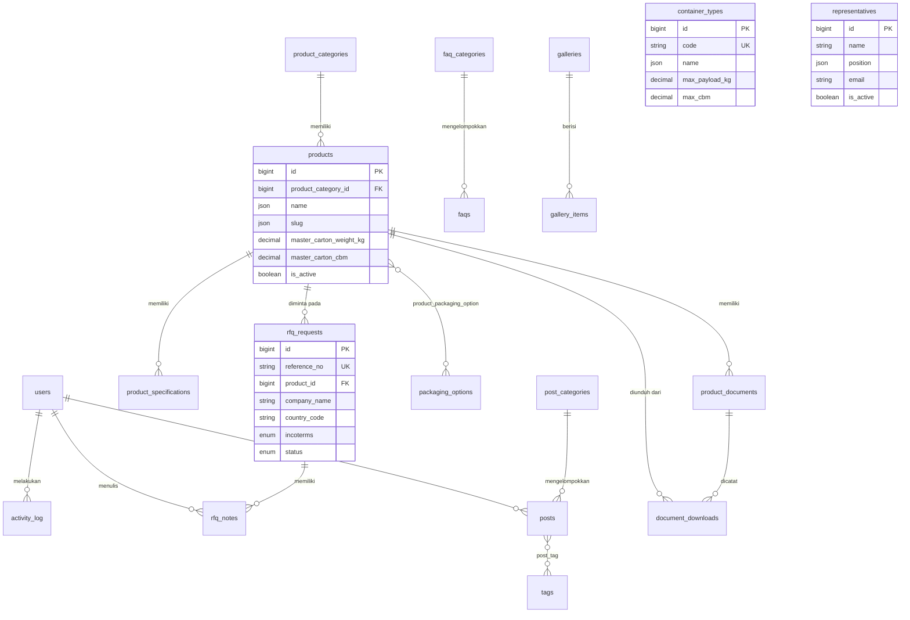

# 04 — ERD & Skema Database

**Database:** MySQL 8.0+
**Engine:** InnoDB
**Charset:** `utf8mb4` / Collation: `utf8mb4_unicode_ci` — wajib, karena menyimpan aksara Arab dan Kiril.

---

## 1. Prinsip Skema

| Prinsip | Penerapan |
|---------|-----------|
| **Primary key** | `BIGINT UNSIGNED AUTO_INCREMENT` (`$table->id()`) |
| **Multi-bahasa** | Kolom `JSON` bertipe translatable, format `{"en": "...", "ar": "...", "ru": "..."}` |
| **Soft delete** | Aktif di seluruh master data dan konten. **Tidak aktif** di `rfq_requests`, `contact_messages`, `activity_log` |
| **Timestamps** | `created_at`, `updated_at` di semua tabel. Disimpan UTC, ditampilkan WIB |
| **Audit** | `created_by`, `updated_by` (nullable FK ke `users`) pada tabel sensitif |
| **Urutan** | `sort_order` INT UNSIGNED default 0, dipakai untuk drag-and-drop |
| **Status** | `is_active` BOOLEAN default true; blog memakai enum `status` tersendiri |
| **Uang** | `BIGINT` menyimpan nilai dalam satuan terkecil (Rupiah utuh, tanpa desimal) |
| **Berat & Volume** | `DECIMAL(10,3)` — presisi 3 desimal cukup untuk kg dan CBM |
| **Slug** | JSON translatable, unik per locale, divalidasi di level aplikasi |

### Kenapa JSON, bukan tabel terjemahan terpisah

Konten situs ini bervolume sedang (puluhan produk, ratusan artikel), dan hampir setiap query membutuhkan semua field sekaligus. Tabel terjemahan terpisah akan menambah JOIN di hampir setiap query tanpa manfaat yang sebanding. Kolom JSON juga membuat form admin jauh lebih sederhana: satu record, tiga tab.

Konsekuensi yang harus diterima: pencarian teks per locale memerlukan `JSON_EXTRACT` atau generated column. Untuk pencarian artikel, tambahkan generated column ber-index:

```sql
ALTER TABLE posts
  ADD COLUMN title_en VARCHAR(255)
  GENERATED ALWAYS AS (JSON_UNQUOTE(JSON_EXTRACT(title, '$.en'))) STORED,
  ADD INDEX idx_posts_title_en (title_en);
```

---

## 2. Diagram Relasi



Tabel yang berdiri sendiri tanpa relasi (konten terkelola): `certificates`, `production_steps`, `qc_protocols`, `features`, `shipping_partners`, `team_members`, `representatives`, `page_blocks`, `site_settings`, `contact_messages`, `media`.

---

## 3. Definisi Tabel

### 3.1 Autentikasi & Sistem

#### `users`
| Kolom | Tipe | Keterangan |
|-------|------|------------|
| id | BIGINT UNSIGNED PK | |
| name | VARCHAR(255) | |
| email | VARCHAR(255) UNIQUE | |
| email_verified_at | TIMESTAMP NULL | |
| password | VARCHAR(255) | |
| two_factor_secret | TEXT NULL | Fortify |
| two_factor_recovery_codes | TEXT NULL | Fortify |
| two_factor_confirmed_at | TIMESTAMP NULL | Fortify |
| avatar_path | VARCHAR(255) NULL | foto profil, rasio 1:1 |
| phone | VARCHAR(50) NULL | |
| ~~position~~ | ~~VARCHAR(255) NULL~~ | **dibatalkan atas permintaan klien** — manajemen pengguna hanya CRUD sederhana, jabatan tidak dipakai di logika mana pun |
| last_login_at | TIMESTAMP NULL | |
| last_login_ip | VARCHAR(45) NULL | IPv6-safe |
| is_active | BOOLEAN default true | |
| remember_token | VARCHAR(100) NULL | |
| timestamps, softDeletes | | |

**Index:** `email` (unique), `is_active`

#### Tabel bawaan paket
- `roles`, `permissions`, `model_has_roles`, `model_has_permissions`, `role_has_permissions` — dari `spatie/laravel-permission`. Seed **satu role**: `admin`.
- `activity_log` — dari `spatie/laravel-activitylog`.
- `media` — dari `spatie/laravel-medialibrary`.
- `sessions`, `cache`, `jobs`, `failed_jobs`, `password_reset_tokens` — bawaan Laravel.

---

### 3.2 Produk

#### `product_categories`
| Kolom | Tipe | Keterangan |
|-------|------|------------|
| id | BIGINT UNSIGNED PK | |
| name | JSON | translatable |
| slug | JSON | translatable, unik per locale |
| description | JSON NULL | translatable |
| icon | VARCHAR(255) NULL | nama ikon lucide |
| sort_order | INT UNSIGNED default 0 | |
| is_active | BOOLEAN default true | |
| timestamps, softDeletes | | |

#### `products`
| Kolom | Tipe | Keterangan |
|-------|------|------------|
| id | BIGINT UNSIGNED PK | |
| product_category_id | BIGINT UNSIGNED FK NULL | `ON DELETE SET NULL` |
| code | VARCHAR(50) UNIQUE | contoh: `SHISHA-PREM-26` |
| name | JSON | translatable |
| slug | JSON | translatable, unik per locale |
| short_description | JSON NULL | translatable, untuk kartu produk |
| description | JSON NULL | translatable, HTML |
| shape | VARCHAR(100) NULL | Cube, Hexagonal, Finger |
| size_mm | VARCHAR(100) NULL | `26 x 26 x 26` |
| **master_carton_weight_kg** | DECIMAL(10,3) NULL | berat isi bersih per master carton |
| **master_carton_tare_kg** | DECIMAL(10,3) NULL | berat karton kosong |
| **master_carton_cbm** | DECIMAL(10,4) NULL | volume per master carton |
| master_carton_length_cm | DECIMAL(8,2) NULL | |
| master_carton_width_cm | DECIMAL(8,2) NULL | |
| master_carton_height_cm | DECIMAL(8,2) NULL | |
| inner_box_weight_kg | DECIMAL(10,3) NULL | |
| inner_boxes_per_carton | SMALLINT UNSIGNED NULL | |
| moq_kg | DECIMAL(12,2) NULL | minimum order quantity |
| meta_title | JSON NULL | translatable |
| meta_description | JSON NULL | translatable |
| sort_order | INT UNSIGNED default 0 | |
| is_active | BOOLEAN default true | |
| is_featured | BOOLEAN default false | tampil di beranda |
| created_by, updated_by | BIGINT UNSIGNED FK NULL | |
| timestamps, softDeletes | | |

**Index:** `product_category_id`, `is_active`, `is_featured`, `sort_order`, `code` (unique)

> **Catatan implementasi:** produk hanya muncul di Container Calculator bila `master_carton_weight_kg` dan `master_carton_cbm` keduanya terisi. Buat scope `scopeCalculable()` dan tampilkan peringatan di admin bila kosong.

#### `product_specifications`
| Kolom | Tipe | Keterangan |
|-------|------|------------|
| id | BIGINT UNSIGNED PK | |
| product_id | BIGINT UNSIGNED FK | `ON DELETE CASCADE` |
| parameter | JSON | translatable, contoh: Fixed Carbon |
| value | VARCHAR(255) | contoh: `80% min` |
| unit | VARCHAR(50) NULL | |
| is_highlighted | BOOLEAN default false | disorot warna aksen |
| sort_order | INT UNSIGNED default 0 | |
| timestamps | | |

**Index:** `product_id`, `sort_order`

#### `product_documents`
| Kolom | Tipe | Keterangan |
|-------|------|------------|
| id | BIGINT UNSIGNED PK | |
| product_id | BIGINT UNSIGNED FK | `ON DELETE CASCADE` |
| type | ENUM('coa','msds','sht','packing_list','other') | |
| title | JSON | translatable |
| file_path | VARCHAR(500) | |
| file_name | VARCHAR(255) | nama tampilan |
| file_size | BIGINT UNSIGNED | byte |
| mime_type | VARCHAR(100) | |
| batch_reference | VARCHAR(100) NULL | contoh: `SP-2409` |
| issued_at | DATE NULL | |
| download_count | INT UNSIGNED default 0 | |
| is_active | BOOLEAN default true | |
| timestamps, softDeletes | | |

**Index:** `product_id`, `type`, `is_active`

#### `packaging_options` & `product_packaging_option`
`packaging_options`: `id`, `name` JSON, `description` JSON, `image_path`, `net_weight_kg` DECIMAL(10,3) NULL, `sort_order`, `is_active`, timestamps, softDeletes.

Pivot `product_packaging_option`: `product_id`, `packaging_option_id`, primary key gabungan, `ON DELETE CASCADE` keduanya.

#### `container_types`
| Kolom | Tipe | Keterangan |
|-------|------|------------|
| id | BIGINT UNSIGNED PK | |
| code | VARCHAR(30) UNIQUE | `20FT_DV`, `40FT_HC` |
| name | JSON | translatable |
| max_payload_kg | DECIMAL(10,2) | contoh: `18000.00` |
| max_cbm | DECIMAL(10,2) | contoh: `28.00` |
| internal_length_m | DECIMAL(6,2) NULL | |
| internal_width_m | DECIMAL(6,2) NULL | |
| internal_height_m | DECIMAL(6,2) NULL | |
| sort_order | INT UNSIGNED default 0 | |
| is_active | BOOLEAN default true | |
| timestamps, softDeletes | | |

**Seeder awal:**

| code | name (en) | max_payload_kg | max_cbm | L | W | H |
|------|-----------|----------------|---------|---|---|---|
| 20FT_DV | 20FT Dry Van | 18000.00 | 28.00 | 5.90 | 2.35 | 2.39 |
| 40FT_HC | 40FT High Cube | 26000.00 | 68.00 | 12.03 | 2.35 | 2.69 |

#### `document_downloads`
Pencatatan unduhan dokumen dari sisi publik.

`id`, `product_document_id` FK, `ip_address` VARCHAR(45), `country_code` CHAR(2) NULL, `user_agent` TEXT NULL, `referer` VARCHAR(500) NULL, `locale` CHAR(2), `created_at`.

**Index:** `product_document_id`, `created_at`. Tanpa `updated_at` dan tanpa soft delete.

---

### 3.3 Konten Perusahaan

#### `certificates`
`id`, `name` JSON, `issuer` VARCHAR(255) NULL, `certificate_number` VARCHAR(100) NULL, `description` JSON NULL, `logo_path` VARCHAR(500) NULL, `file_path` VARCHAR(500) NULL, `issued_at` DATE NULL, `expires_at` DATE NULL, `show_in_trust_bar` BOOLEAN default false, `sort_order`, `is_active`, `created_by`, `updated_by`, timestamps, softDeletes.

**Index:** `is_active`, `expires_at`, `show_in_trust_bar`

#### `production_steps`
`id`, `title` JSON, `description` JSON NULL, `image_path` VARCHAR(500) NULL, `sort_order`, `is_active`, timestamps, softDeletes.

#### `qc_protocols`
`id`, `title` JSON, `description` JSON NULL, `result_label` JSON NULL, `result_value` VARCHAR(255) NULL, `image_path` VARCHAR(500) NULL, `sort_order`, `is_active`, timestamps, softDeletes.

Contoh isi: title `Drop Test`, result_label `Breakage tolerance`, result_value `< 2.5%`.

#### `features`
Poin "Why Choose Us". `id`, `title` JSON, `description` JSON NULL, `icon` VARCHAR(100) NULL, `image_path` VARCHAR(500) NULL, `sort_order`, `is_active`, timestamps, softDeletes.

#### `shipping_partners`
`id`, `name` VARCHAR(255), `logo_path` VARCHAR(500), `website_url` VARCHAR(500) NULL, `sort_order`, `is_active`, timestamps, softDeletes.

#### `team_members`
`id`, `name` VARCHAR(255), `position` JSON, `bio` JSON NULL, `photo_path` VARCHAR(500) NULL, `linkedin_url` VARCHAR(500) NULL, `sort_order`, `is_active`, timestamps, softDeletes.

#### `representatives`
| Kolom | Tipe | Keterangan |
|-------|------|------------|
| id | BIGINT UNSIGNED PK | |
| name | VARCHAR(255) | |
| position | JSON | translatable |
| region | VARCHAR(255) NULL | MENA, Europe, Asia |
| email | VARCHAR(255) | wajib domain perusahaan |
| phone | VARCHAR(50) NULL | |
| whatsapp | VARCHAR(50) NULL | |
| photo_path | VARCHAR(500) NULL | |
| started_at | DATE NULL | |
| ended_at | DATE NULL | |
| sort_order | INT UNSIGNED default 0 | |
| is_active | BOOLEAN default true | |
| created_by, updated_by | BIGINT UNSIGNED FK NULL | |
| timestamps, softDeletes | | |

**Index:** `is_active`, `email`

> **Wajib:** model ini menggunakan trait `LogsActivity` dengan `logAll()`. Halaman publik yang bergantung padanya adalah alat pencegah penipuan — perubahan tanpa jejak tidak dapat diterima.

---

### 3.4 Blog & FAQ

#### `post_categories`
`id`, `name` JSON, `slug` JSON, `description` JSON NULL, `sort_order`, `is_active`, timestamps, softDeletes.

#### `posts`
| Kolom | Tipe | Keterangan |
|-------|------|------------|
| id | BIGINT UNSIGNED PK | |
| post_category_id | BIGINT UNSIGNED FK NULL | `ON DELETE SET NULL` |
| user_id | BIGINT UNSIGNED FK NULL | penulis |
| title | JSON | translatable |
| slug | JSON | translatable, unik per locale |
| excerpt | JSON NULL | translatable |
| content | JSON NULL | translatable, HTML |
| cover_path | VARCHAR(500) NULL | |
| meta_title | JSON NULL | |
| meta_description | JSON NULL | |
| status | ENUM('draft','scheduled','published','archived') default 'draft' | |
| published_at | TIMESTAMP NULL | |
| view_count | INT UNSIGNED default 0 | |
| reading_minutes | TINYINT UNSIGNED NULL | dihitung otomatis |
| timestamps, softDeletes | | |

**Index:** `post_category_id`, `status`, `published_at`, gabungan `(status, published_at)`

Tambahkan generated column ber-index untuk `title_en` guna mempercepat pencarian.

#### `tags` & `post_tag`
`tags`: `id`, `name` JSON, `slug` JSON, timestamps.
`post_tag`: `post_id`, `tag_id`, PK gabungan, cascade delete.

#### `faq_categories`
`id`, `name` JSON, `sort_order`, `is_active`, timestamps, softDeletes.

#### `faqs`
`id`, `faq_category_id` FK NULL, `question` JSON, `answer` JSON, `sort_order`, `is_active`, timestamps, softDeletes.

---

### 3.5 Galeri & Halaman Statis

#### `galleries`
`id`, `title` JSON, `description` JSON NULL, `slug` JSON, `cover_path` VARCHAR(500) NULL, `sort_order`, `is_active`, timestamps, softDeletes.

#### `gallery_items`
`id`, `gallery_id` FK cascade, `type` ENUM('image','video'), `file_path` VARCHAR(500) NULL, `video_url` VARCHAR(500) NULL, `caption` JSON NULL, `sort_order`, timestamps.

#### `page_blocks`
Konten halaman statis yang bisa diubah admin tanpa mengubah struktur.

| Kolom | Tipe | Keterangan |
|-------|------|------------|
| id | BIGINT UNSIGNED PK | |
| page_key | VARCHAR(100) | `about`, `export_info`, `home` |
| block_key | VARCHAR(100) | `company_profile`, `supply_chain_position` |
| type | ENUM('rich_text','text_image','list','stat') default 'rich_text' | |
| title | JSON NULL | |
| content | JSON NULL | |
| image_path | VARCHAR(500) NULL | |
| extra | JSON NULL | data tambahan sesuai tipe |
| sort_order | INT UNSIGNED default 0 | |
| is_active | BOOLEAN default true | |
| timestamps | | |

**Unique index:** gabungan `(page_key, block_key)`

Blok di-seed dari awal. Admin hanya bisa mengubah isi, tidak bisa menambah atau menghapus kunci dari UI.

---

### 3.6 Leads

#### `rfq_requests`
| Kolom | Tipe | Keterangan |
|-------|------|------------|
| id | BIGINT UNSIGNED PK | |
| reference_no | VARCHAR(30) UNIQUE | `RFQ-20260802-0001` |
| product_id | BIGINT UNSIGNED FK NULL | `ON DELETE SET NULL` |
| company_name | VARCHAR(255) | |
| contact_name | VARCHAR(255) NULL | |
| email | VARCHAR(255) | |
| phone | VARCHAR(50) NULL | |
| whatsapp | VARCHAR(50) NULL | |
| country_code | CHAR(2) | ISO 3166-1 alpha-2 |
| incoterms | ENUM('FOB','CIF','CFR','EXW','OTHER') NULL | |
| port_of_destination | VARCHAR(255) NULL | |
| monthly_tonnage | VARCHAR(100) NULL | teks bebas, buyer menulis beragam format |
| container_type_id | BIGINT UNSIGNED FK NULL | |
| packaging_notes | TEXT NULL | |
| message | TEXT NULL | |
| status | ENUM('new','contacted','quoted','negotiating','won','lost','spam') default 'new' | |
| is_read | BOOLEAN default false | |
| locale | CHAR(2) | bahasa saat submit |
| source_url | VARCHAR(500) NULL | halaman asal |
| ip_address | VARCHAR(45) NULL | |
| user_agent | TEXT NULL | |
| timestamps | **tanpa** softDeletes | |

**Index:** `status`, `country_code`, `is_read`, `created_at`, gabungan `(status, created_at)`

> `monthly_tonnage` sengaja bertipe VARCHAR. Buyer menulis dengan format yang sangat beragam (`54 MT`, `3 x 40HC`, `two containers monthly`). Memaksa tipe numerik akan membuat submission gagal dan kehilangan lead.

#### `rfq_notes`
`id`, `rfq_request_id` FK cascade, `user_id` FK NULL, `note` TEXT, `timestamps`.

#### `contact_messages`
`id`, `name`, `email`, `phone` NULL, `subject` NULL, `message` TEXT, `is_read` BOOLEAN, `is_spam` BOOLEAN, `locale`, `ip_address`, `user_agent`, timestamps.

---

### 3.7 Pengaturan

#### `site_settings`
Pola key-value agar penambahan pengaturan tidak memerlukan migrasi.

| Kolom | Tipe | Keterangan |
|-------|------|------------|
| id | BIGINT UNSIGNED PK | |
| group | VARCHAR(50) | `identity`, `contact`, `social`, `seo`, `email`, `system` |
| key | VARCHAR(100) UNIQUE | |
| label | VARCHAR(255) | teks label di form admin |
| description | VARCHAR(500) NULL | helper text di bawah field |
| value | JSON NULL | |
| type | ENUM('string','text','number','boolean','json','image','file','email_list','translatable','color','coordinate') | menentukan komponen input di admin |
| rules | JSON NULL | aturan validasi tambahan |
| sort_order | INT UNSIGNED default 0 | urutan tampil dalam grup |
| is_public | BOOLEAN default true | ikut dikirim ke frontend publik atau tidak |
| timestamps | | |

**Index:** `key` (unique), `group`, gabungan `(group, sort_order)`

Kolom `type` menentukan komponen yang dirender otomatis di halaman pengaturan. Dengan begitu menambah pengaturan baru cukup lewat seeder, tanpa menyentuh komponen React.

#### Daftar Lengkap Kunci yang Di-seed

**Grup `identity`**

| key | type | Keterangan |
|-----|------|------------|
| `company_name` | string | Nama dagang |
| `legal_name` | string | Nama badan hukum, contoh: PT Nusa Carbon Indonesia |
| `tagline` | translatable | Tagline tiga bahasa |
| `about_short` | translatable | Deskripsi singkat untuk footer & meta |
| `logo_primary` | image | Logo, dipakai di header, footer, dan dokumen |
| `favicon` | image | ICO/PNG 32×32 |
| `founded_year` | number | |
| `nib` | string | Nomor Induk Berusaha |
| `npwp` | string | |
| `export_id` | string | API-U / Exporter ID |
| `hs_code` | string | Default `4402.90.90` |

> Varian `logo_secondary`, `logo_square`, dan `apple_touch_icon` dibatalkan atas permintaan klien: satu logo dan satu favicon sudah cukup, dan berkas yang tidak pernah diunggah hanya membuat halaman pengaturan terlihat menuntut.

**Grup `contact`**

| key | type | Keterangan |
|-----|------|------------|
| `address` | translatable | Alamat lengkap |
| `city` | string | |
| `province` | string | |
| `postal_code` | string | |
| `country` | string | |
| `map_lat` | coordinate | Latitude |
| `map_lng` | coordinate | Longitude |
| `map_embed_url` | string | URL Google Maps embed |
| `phone` | string | Telepon kantor |
| `whatsapp` | string | Nomor WhatsApp format internasional |
| `whatsapp_default_message` | translatable | Pesan awal saat tombol WA diklik |
| `email` | string | Email utama |
| `email_sales` | string | |
| `office_hours` | translatable | Jam operasional |

**Grup `social`**

| key | type |
|-----|------|
| `facebook_url` | string |
| `instagram_url` | string |
| `linkedin_url` | string |
| `youtube_url` | string |
| `tiktok_url` | string |
| `x_url` | string |
| `alibaba_url` | string |

Kunci sosial media yang kosong tidak dirender di footer.

**Grup `seo`**

| key | type | Keterangan |
|-----|------|------------|
| `default_meta_title` | translatable | |
| `default_meta_description` | translatable | |
| `default_og_image` | image | 1200×630 |
| `meta_keywords` | translatable | |
| `google_analytics_id` | string | |
| `google_tag_manager_id` | string | |
| `google_site_verification` | string | |
| `bing_site_verification` | string | |
| `yandex_verification` | string | penting untuk pasar Rusia |
| `facebook_pixel_id` | string | |
| `robots_index` | boolean | matikan saat staging |
| `sitemap_enabled` | boolean | |

**Grup `email`**

| key | type | Keterangan |
|-----|------|------------|
| `rfq_notification_recipients` | email_list | Bisa lebih dari satu, dipisah koma |
| `contact_notification_recipients` | email_list | |
| `mail_from_name` | string | |
| `mail_from_address` | string | |
| `send_buyer_confirmation` | boolean | Kirim email konfirmasi otomatis ke buyer |

**Grup `system`**

| key | type | Keterangan |
|-----|------|------------|
| `active_theme_admin` | number | FK longgar ke `themes.id` |
| `active_theme_public` | number | FK longgar ke `themes.id` |
| `maintenance_mode` | boolean | |
| `maintenance_message` | translatable | |
| `rfq_rate_limit_per_hour` | number | default 5 |
| `turnstile_site_key` | string | |
| `turnstile_secret_key` | string | disimpan terenkripsi |

Kunci bertanda rahasia (`turnstile_secret_key`, kredensial lain) dienkripsi dengan `Crypt::encryptString()` sebelum disimpan dan tidak pernah dikirim ke frontend.

Bungkus dengan `SettingService` yang melakukan cache permanen dan invalidasi saat ada perubahan. Jangan query tabel ini langsung dari view atau controller.

---

#### `themes`

Menyimpan palet warna yang bisa dikustomisasi admin. Berlaku terpisah untuk admin panel dan website publik.

| Kolom | Tipe | Keterangan |
|-------|------|------------|
| id | BIGINT UNSIGNED PK | |
| name | VARCHAR(100) | Nama palet, contoh: `Ember Default` |
| slug | VARCHAR(100) UNIQUE | |
| scope | ENUM('admin','public','both') default 'both' | Palet ini boleh dipakai di mana |
| tokens | JSON | Seluruh nilai warna & radius |
| is_preset | BOOLEAN default false | Preset bawaan, tidak bisa dihapus |
| is_active_admin | BOOLEAN default false | |
| is_active_public | BOOLEAN default false | |
| created_by, updated_by | BIGINT UNSIGNED FK NULL | |
| timestamps, softDeletes | | |

**Index:** `slug` (unique), `scope`, `is_active_admin`, `is_active_public`

**Struktur kolom `tokens`:**

```json
{
  "primary":            "#C94A17",
  "primary_foreground": "#FFFFFF",
  "secondary":          "#F5F5F3",
  "secondary_foreground": "#131418",
  "accent":             "#96741A",
  "accent_foreground":  "#FFFFFF",
  "background":         "#F7F7F4",
  "foreground":         "#131418",
  "card":               "#FFFFFF",
  "card_foreground":    "#131418",
  "muted":              "#F1F1EE",
  "muted_foreground":   "#6B6E74",
  "border":             "#E1E1DA",
  "input":              "#E1E1DA",
  "ring":               "#C94A17",
  "success":            "#15803D",
  "success_foreground": "#FFFFFF",
  "destructive":        "#B91C1C",
  "destructive_foreground": "#FFFFFF",
  "warning":            "#B45309",
  "warning_foreground": "#FFFFFF",
  "info":               "#1D4ED8",
  "info_foreground":    "#FFFFFF",
  "neutral":            "#4B5563",
  "neutral_foreground": "#FFFFFF",
  "violet":             "#6D28D9",
  "violet_foreground":  "#FFFFFF",
  "teal":               "#0F766E",
  "teal_foreground":    "#FFFFFF",
  "sidebar":            "#FAFAF8",
  "sidebar_foreground": "#131418",
  "sidebar_accent":     "#F0EFEB",
  "sidebar_border":     "#E1E1DA",
  "radius":             "0.5rem"
}
```

Seluruh kunci wajib ada. Validasi memakai daftar kunci tetap; kunci yang tidak dikenal ditolak agar tidak ada token liar yang tidak terpakai.

**Preset yang di-seed:**

| slug | name | scope | Keterangan |
|------|------|-------|------------|
| `ember-light` | Ember Light | both | Default admin — putih, aksen jingga bata |
| `charcoal-dark` | Charcoal Industrial | public | Default publik — charcoal, ember, gold |
| `slate-neutral` | Slate Neutral | both | Netral abu-biru |
| `forest-green` | Forest Green | both | Aksen hijau |
| `navy-corporate` | Navy Corporate | both | Aksen biru tua |

Preset (`is_preset = true`) tidak dapat dihapus maupun diubah. Admin yang ingin memodifikasinya menekan "Duplikat" untuk membuat salinan yang bisa diedit.

Hanya boleh ada satu baris dengan `is_active_admin = true` dan satu dengan `is_active_public = true`. Ini ditegakkan lewat `ActivateThemeAction` di dalam transaksi, bukan lewat constraint database.

Detail implementasi: lihat [10-theming.md](./10-theming.md).

---

## 4. Ringkasan Foreign Key

| Tabel anak | Kolom | Tabel induk | On Delete |
|------------|-------|-------------|-----------|
| products | product_category_id | product_categories | SET NULL |
| product_specifications | product_id | products | CASCADE |
| product_documents | product_id | products | CASCADE |
| product_packaging_option | product_id | products | CASCADE |
| product_packaging_option | packaging_option_id | packaging_options | CASCADE |
| document_downloads | product_document_id | product_documents | CASCADE |
| posts | post_category_id | post_categories | SET NULL |
| posts | user_id | users | SET NULL |
| post_tag | post_id | posts | CASCADE |
| post_tag | tag_id | tags | CASCADE |
| faqs | faq_category_id | faq_categories | SET NULL |
| gallery_items | gallery_id | galleries | CASCADE |
| rfq_requests | product_id | products | SET NULL |
| rfq_requests | container_type_id | container_types | SET NULL |
| rfq_notes | rfq_request_id | rfq_requests | CASCADE |
| rfq_notes | user_id | users | SET NULL |

`SET NULL` dipakai pada relasi ke data yang boleh hilang tanpa menghancurkan riwayat. RFQ dari dua tahun lalu tetap harus terbaca meski produknya sudah tidak dijual.

---

## 5. Catatan Migrasi

1. Urutan migrasi: `users` → master tanpa FK → tabel dengan FK → pivot → leads.
2. Seluruh kolom JSON translatable dideklarasikan `->nullable()` kecuali yang benar-benar wajib, karena bahasa selain EN diisi belakangan.
3. Gunakan `$table->foreignId(...)->constrained()->nullOnDelete()` atau `->cascadeOnDelete()` secara eksplisit — jangan mengandalkan default.
4. Tambahkan index komposit setelah pola query stabil, bukan di awal.
5. Factory dan seeder wajib untuk seluruh tabel guna mendukung Pest test.
